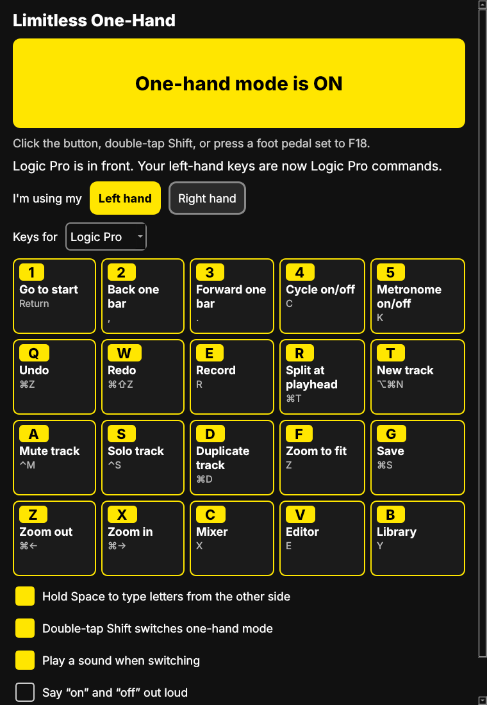

# Limitless One-Hand

Part of **Limitless Sound**: music software that leaves no one out.

Limitless One-Hand lets you run Logic Pro and Pro Tools with one hand. Switch on one-hand mode and the keys under your hand become the DAW commands you use most: play, record, undo, split, mute, solo, zoom, save. Switch it off and your keyboard is normal again.



## Works on

- **macOS 12 or later**, Apple Silicon and Intel: Logic Pro and Pro Tools
- **Windows 10 and 11**: Pro Tools

Any keyboard works. Nothing else to install.

## Get it

Download the newest `one-hand-v…` release from the repository's **Releases** page:

- Mac: `Limitless-One-Hand-mac-apple-silicon.dmg` (M1 and newer) or `-mac-intel.dmg`. Open it and drag the app into Applications.
- Windows: `Limitless-One-Hand-windows.exe`. Double-click it to install; it adds Limitless One-Hand to the Start menu.

### First time on a Mac

1. The app is not yet signed by Apple, so the first time, **right-click the app and choose Open**, then Open again.
2. macOS will ask to let the app use the keyboard. Go to **System Settings → Privacy & Security** and switch on **Limitless One-Hand** under both **Accessibility** and **Input Monitoring**. Then press **Try again** in the app.
3. For Pro Tools record (⌘Space), turn off the Spotlight shortcut in System Settings → Keyboard → Keyboard Shortcuts → Spotlight.

### First time on Windows

Windows may show "Windows protected your PC" because the app is new. Choose **More info → Run anyway**.

## Using it

- **Switch on or off:** click the big button, **double-tap Shift** (either side), or press **F18**. F18 is for a foot pedal, Stream Deck, Xbox Adaptive Controller, or any switch that can send a key. On Windows you can also choose Caps Lock.
- **Pick your hand:** Left hand or Right hand. The right-hand layout is the mirror image, so each finger does the same job.
- **Space still plays and stops.** Hold Space and press a key to type the letter from the other half of the keyboard, handy for naming tracks. (Space now acts when you let go.)
- Real shortcuts still work: if you hold ⌘/Ctrl, Option/Alt or Shift, keys pass straight through.
- Keys only change while Logic Pro or Pro Tools is in front. Every other app types normally.
- Sound and spoken "on/off" feedback, and "keep window on top", are in the options.
- Works alongside on-screen keyboards, Switch Control, Voice Control and other assistive tools: keys they type go through one-hand mode too.

For two-key shortcuts one finger at a time, also turn on Sticky Keys (Mac: Accessibility → Keyboard; Windows: Settings → Accessibility → Keyboard).

## Changing the commands

Copy `onehand/layouts.json` into the settings folder and edit it, then restart the app:

- Mac: `~/Library/Application Support/Limitless One-Hand/layouts.json`
- Windows: `%APPDATA%\Limitless One-Hand\layouts.json`

Keys are written for the left hand; the right-hand layout is worked out for you. Modifiers use Mac names (command, option, control, shift) and become Ctrl, Alt, Win and Shift on Windows. To add another app, add an entry with its Mac bundle ID and/or Windows program name (for example `Ableton Live 12 Suite.exe`).

## For developers

```sh
pip install -r requirements.txt pytest
python -m pytest           # engine tests
python main.py             # run the app
python main.py --self-test # load the keyboard code and check the hook
pyinstaller onehand.spec   # build the app for this system
```

`onehand/engine.py` holds all the remapping logic and has no system calls. `platform_mac.py` (Quartz event tap) and `platform_win.py` (low-level keyboard hook) feed it key events and carry out what it returns. `.github/workflows/one-hand.yml` (at the repository root) builds the Mac disk images and the Windows installer for every change to this folder, and attaches them to a release when a `one-hand-v*` tag is pushed.

## Known limits

- Not yet signed with an Apple Developer ID or a Windows code-signing certificate, so first launch shows a warning.
- Shortcuts are the DAWs' factory defaults; if you changed yours, edit the layout.
- Password fields block all keyboard tools on macOS, so one-hand mode pauses there.
