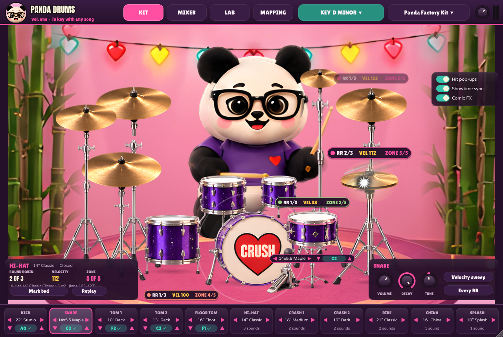
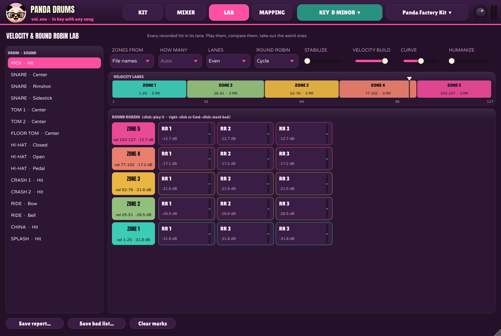
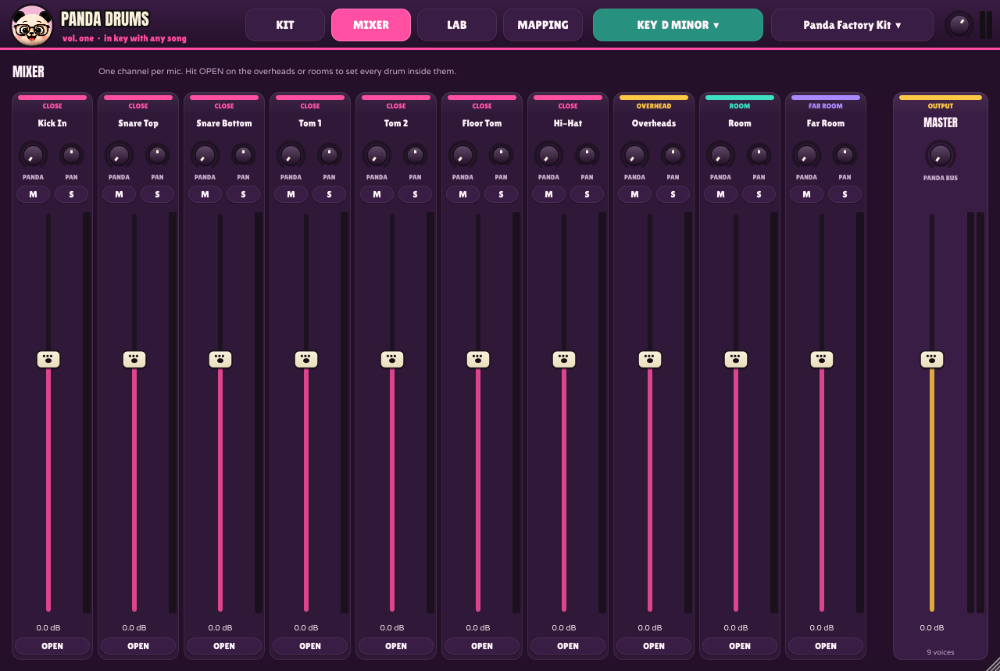
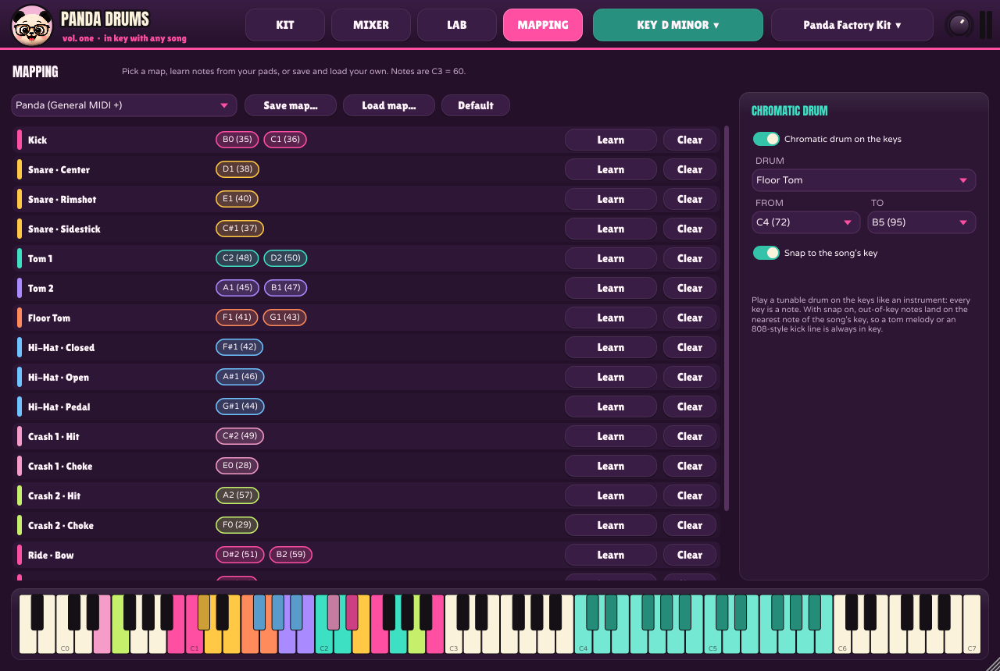

# Panda Drums vol. one

The first drum plugin that plays **in key with any song**, and the drummer is a **panda**.
Pick the song's key and every kick, snare and tom tunes itself onto its notes. Play a tom
across the keyboard like an instrument. And the plush panda in glasses sits behind a purple
glitter kit and plays every hit your MIDI sends, in time.

AU, VST3 and stand-alone, for macOS 11+ (Apple silicon and Intel in one) and Windows 10/11.


| | |
|---|---|
|  |  |
|  |  |

## What changed from V0.0.4

| What was asked for | Where it is |
|---|---|
| Every recorded velocity stabilized and put into zones | Each sound's hits are sorted into velocity **zones** (lanes of 1-127), from the layer number in the file name or by how loud they really are. **Stabilize** pulls every round robin of a zone to the same level. **Velocity build** fades the bottom of each lane down to the lane below, so velocity is one smooth build, not steps. |
| A pop-up on the drum page showing which round and what velocity | Every hit pops up on its drum: `RR 2/3 · VEL 98 · ZONE 4/5`. The **Last hit** card says the same in big type, plus the sample's file name and its lane. |
| Test which hits are weird and take them out ("the fourth round robin of this drum") | **Lab** page: every hit of a sound in a grid, zones by round robins. Click to play one, right-click to mark it bad (it's skipped from then on and remembered with the song). **Mark bad** on the Last hit card does it while playing. Save the full report or just the bad list as a text file to send on. |
| Kick and tom sizes change visually with the drum chosen | Each drum is drawn at its real size (22" vs 24" kick, 10" vs 12" tom...), read from the folder name or `panda-kit.json`. |
| The up/down arrows should actually change the pitch | ▲ ▼ under every tunable drum step to the next note **of the song's key** (any note when no key is set). |
| Sub-bars saying which snare it is, with arrows to change it in real time | The drum strip under the stage: ◀ name ▶ for every drum and cymbal. Swapping works while playing (a drum loads the first time it's picked, then it's instant). Cymbals too: one click, no menu. |
| Use the drum mics that were actually used | One mixer channel per mic found in the samples. `panda-kit.json` (Kit menu > Write panda-kit.json) lists them so the real names and groups can be checked and fixed by hand. |
| Open the overheads and rooms and use faders inside them | **OPEN** on any channel shows a fader for every drum inside that mic (kick in the overheads, snare in the far room...). |
| A Panda effect on each fader | **PANDA** knob on every channel and on the master bus. For now it's a punch-and-grit chain (compressor into saturation); the real Panda chain drops into the same knob. |
| A default map, saved maps, Superior Drummer style, import your own | **Mapping** page: Panda (General MIDI +), General MIDI, Toontrack style (SD3 / EZdrummer), Roland V-Drums. Save, load, MIDI-learn from your pads. |
| A menu bar item for the song's key | **KEY** at the top: pick the root and scale; the kit retunes itself. |
| The panda playing the drums along with the MIDI | The whole stage is the Panda Drums art (the panda, the purple glitter kit, gold cymbals, the CRUSH kick, bamboo and heart lights; see [art/](art/README.md)). He switches to the pose for what he's playing (hi-hat, snare, toms, crashes, kick, fills) on every hit, with a stick streak and a spark; the hi-hat opens and closes with the pedal; he bobs to the host's tempo. Twelve faces and a blink follow the playing: focused, happy, excited, laughing on a big crash, surprised after a rest, a wink when idle, and he cheers with both sticks up when the song stops. **Showtime sync** lands every pose exactly on the sound. |

## Install

**Mac:** open `Panda-Drums-<version>-mac.pkg` and click through. It installs the Audio Unit
(Logic, GarageBand), the VST3 and the app; untick any you don't want under Customize. It isn't
signed by Apple yet, so the first time macOS refuses: System Settings > Privacy & Security >
**Open Anyway**. In Logic, rescan with Logic Pro > Settings > Plug-in Manager if it doesn't
show up under Instruments > The Panda Studios.

**Windows:** run `Panda-Drums-Setup-windows.exe`. SmartScreen: More info > Run anyway.
The VST3 goes to `C:\Program Files\Common Files\VST3`.

## Load your kit

Kit menu (top right) > **Load my kit folder...**. One folder per drum, then optionally one
folder per drum you can swap to, then optionally one folder per articulation:

```
Panda Drums vol 1/
  panda-kit.json                 optional: names, sizes, pitches, which mic is which
  Kick/
    22 Ludwig/                   a drum you can swap to; its size is read from the name
      Kick_In_V1_RR1.wav         velocity layer 1, round robin 1, on the Kick In mic
      Kick_Out_V1_RR1.wav        same hit, another mic
      Kick_OH_V1_RR1.wav         same hit in the overheads (stereo files are fine)
      Kick_Room_Far_V1_RR1.wav
    24 Vintage/...
  Snare/
    14x6.5 Brass/
      Center/Snare_Top_V3_RR4.wav
      Rimshot/...
  Tom 1/  Tom 2/  Floor Tom/  Hi-Hat/  Crash 1/  Ride/ ...
```

Names are read loosely:

- **Velocity layer:** `V3`, `vel03`, `layer 3`, `L3`. Without one, the hits are zoned by loudness.
- **Round robin:** `RR2`, `rr02`, `rob2`, `take 2`. Two bare numbers (`Snare Top 3 2`) mean layer 3, round robin 2.
- **Mic:** whatever is left. `In`, `Top`, `Close` become "Kick In", "Snare Top"...; `OH` is the
  overheads; anything with `room` or `far` goes to the rooms. The same mic across drums is one channel.
- **Articulation:** a folder, or a word in the name: center, rimshot, sidestick, open, closed,
  pedal, half, bell, bow, edge, choke.
- Layers can be numbered either way round (v1 = softest or loudest): zones are ordered by how
  loud the hits really are.

Then write `panda-kit.json` from the Kit menu, check the mic names and groups, the drum sizes
and pitches (`pitchHz`), edit and reload. Missing pitches are found by pitch detection.

## The pages

- **Kit:** the panda and the kit. Click a drum to play it (the middle is loud, the edge soft;
  Shift = full force, Option/Alt = soft). Right-click for every articulation. The panel at the
  bottom right has volume, decay and fine tune for the selected drum, a **Velocity sweep**
  (soft to hard through every zone) and **Every RR** (each round robin of one zone in turn).
- **Mixer:** a channel per mic: Panda FX, pan, mute, solo, fader and meter. **OPEN** shows the
  drums inside a mic.
- **Lab:** zones from file names or loudness, how many zones, even or loudness-shaped lanes,
  round robin order (cycle, random without repeats, random), stabilize, velocity build, curve
  and humanize. The lanes and the grid of every hit.
- **Mapping:** maps, learn, save and load, and the **chromatic drum**: a range of keys (C4-B5
  by default) plays one tunable drum at the note pressed, snapped to the song's key if you like.

## Showtime sync

With Showtime on, the plugin reports 75 ms of latency, which the DAW compensates on playback,
so the panda knows every hit 75 ms before you hear it and swings into it. Turn it off when
playing live from pads or a keyboard. Without it, the sticks snap down the moment a hit
sounds (with a motion smear), with no latency at all.

## For developers

```
cmake -B build -DCMAKE_BUILD_TYPE=Release       # JUCE 8 is fetched from GitHub
cmake --build build --target PandaDrums_AU PandaDrums_VST3 PandaDrums_Standalone
cmake --build build --target PandaDrumsTests && build/PandaDrumsTests_artefacts/Release/PandaDrumsTests
```

`PandaDrumsRender screenshots <dir>` draws every page; `PandaDrumsRender video <dir> 18` films
the panda playing a groove frame by frame with the matching audio (join with ffmpeg, as the
workflow does); `PandaDrumsRender levels` prints each drum's level through the mix.

Layout: `Source/engine` (kit model, folder loader, velocity zones, keys, maps, sampler, mixer,
factory kit), `Source/gui` (the stage animation, the art loader, the pages), `art` (the
sprite sheet and the scripts that cut, upscale and lay out its pieces; the layers are in
`Resources/art`),
`tests`, `tools`, `packaging`. CI: `.github/workflows/panda-drums.yml` runs the tests on Linux,
macOS and Windows, validates the Audio Unit with `auval` and the VST3 with pluginval, builds the
Mac `.pkg` and Windows installer, and renders the screenshots and demo video. A
`panda-drums-v*` tag publishes a release.

## Not done yet

- Built and tested in CI and on Linux; not yet tried by hand in Logic, Ableton or Pro Tools.
- No AAX (Pro Tools): it needs Avid's SDK and PACE signing.
- Not signed or notarized (needs an Apple Developer ID and a Windows certificate).
- The factory kit is synthesized so the plugin plays out of the box; the real Panda Drums
  recordings load from their folder.
- The Panda FX chain is a stand-in until the real chain is designed.
- The Toontrack-style map covers the core notes (kick, snares, toms, hats, cymbals); check the
  extras against your version.
- JUCE is used under its free licence for small companies (or AGPLv3); a commercial release
  above JUCE's revenue limit needs a JUCE licence. The fonts (Anton, Lilita One, Varela Round)
  are under the SIL Open Font License, in `Resources/fonts`.
