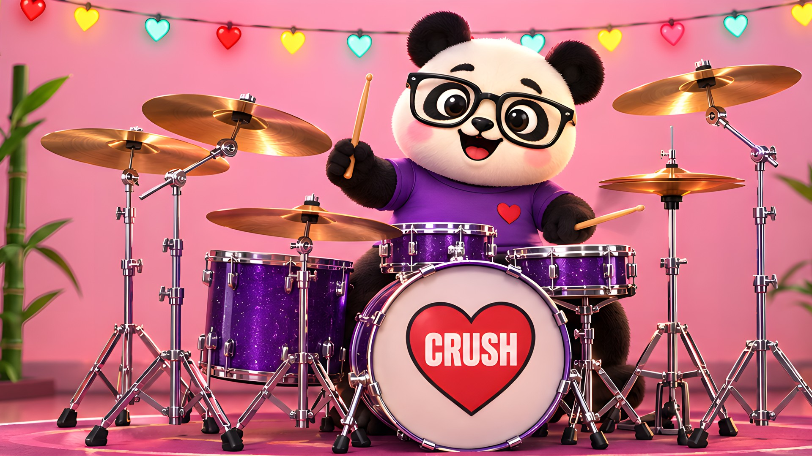

# The panda, the kit, the room and the controls

Everything on screen comes from the Panda Drums art. The Kit page is the hero picture
(`hero.jpg`, the panda at his kit) cut into layers and brought to life: every drum and cymbal
is its own layer, and the panda is a rig that plays them. The sprite sheet
(`source_sprite_sheet.png`, from the GUI asset pack) gives the effects (motion streaks, sparks,
hearts), the badge and one face; every control (panels, buttons, the knob, toggles, instrument
tiles, readouts, icons) is one of the pack's `ui` pieces. `Resources/art` and `Resources/ui`
hold what the scripts below make.



## Build the layers

Needs Python 3.11+ with numpy, Pillow, OpenCV and torch (CPU is fine), and two model files from
GitHub releases: Real-ESRGAN's `RealESRGAN_x4plus.pth` (xinntao/Real-ESRGAN) and LaMa's
`big-lama.pt` (Sanster/models).

```
python sheet_cut.py source_sprite_sheet.png RealESRGAN_x4plus.pth pieces/     # the sheet, cut + 4x
HERO_SCALE=2.725 ESRGAN=RealESRGAN_x4plus.pth LAMA=big-lama.pt python hero_layers.py hero.jpg layers/
python hero_stage.py layers/ pieces/ out/                                     # the stage + manifest
cp out/* ../Resources/art/
python ui_prep.py <pack>/ui RealESRGAN_x4plus.pth ui/                         # the controls
cp ui/* ../Resources/ui/
```

- `sheet_cut.py` cuts each piece of the sheet out by its box, bleeds its colours under the
  transparent edge (so it never gets a dark fringe when scaled) and upscales it 4x with
  Real-ESRGAN, colour and alpha separately.
- `hero_layers.py` upscales the hero picture 4x and takes it apart (at 2.725 hero pixels to one,
  so the kit stays sharp when it's drawn bigger: `HERO_SCALE=2.725`). Every piece is traced in
  the picture's own pixels: each
  cymbal's disc, the hi-hat's two lens-shaped plates split where they meet, each drum, the
  panda's head, torso, sleeves and arms, and the china's stand in front of the floor tom.
  Inside its outline a piece takes everything that isn't the pink wall; an arm gives back
  anything not joined to it.
  - What moves is painted out of the room: the cymbals (they swing), his head, torso and
    arms. Behind those the wall is carried in smoothly from round them (an inpainted membrane,
    with the wall's grain), easing into the picture's own wall across a ring, and the heart
    lights' string is drawn on behind his ear.
  - The kit as it stands in the room (the stands, the drums, the pedals, his legs behind them)
    is a layer of its own, `kit_still`, so the plugin can draw the kit bigger than the picture
    has it. The chrome mirrors the pink room, so a stand is found by its edges and filled
    across, and its layer takes whatever differs from the room behind it. The outer cymbals'
    stands are cut apart from it (`kit_left`, `kit_right`).
  - `backdrop.png` is the room without the kit: the wall carried in smoothly from the picture's
    own wall (over the kit, behind him and wherever a cymbal was), and the floor carried on
    along its rows, as it runs across the picture (a fill that looks round would draw the legs
    back in).
  - Each piece's soft edge (a guided filter; for his fur, a band where his last tufts are told
    from the wall by colour) has its colour unmixed from exactly what's drawn behind it.
  - LaMa paints in what one piece hid of another, and only that (the crash behind the ride,
    the bottom hi-hat under the top one, the shirt under his arms, chin and the drums).
  For the rig it cuts:
  - both fists, each with its stick painted out of it in fur (the left one is its own shape,
    holding its stick level);
  - the whole stick, upright, carried on through the fist to a rounded butt;
  - a ball of his own fur, lit like the fists: the plugin strings them into his arms;
  - both arms exactly as the picture has them, for him at rest.
- `hero_stage.py` lays the layers out on the 1280 x 736 stage, at 1x and 2x, with
  `manifest.json`. The kit is drawn 1.3 times the picture's size (`KIT_GROW`), about where his
  sticks meet the heads, so the drums he plays stay under his hands while the kick and the
  stands run on past the bottom of the stage. The panda stays the picture's size: a drummer
  behind a big rock kit. The outer cymbals and their stands grow with the kit and then move back
  in (`GROUP_SHIFT`), as a drummer sets his cymbals within reach: the near edge of each is where
  the picture has it. The manifest has:
  - where each layer sits, the drum heads and cymbal discs, and the slots other kits' drums go in;
  - the rig's points: the shoulders, each fist's fulcrum and wrist, the stick's length either
    side of the fulcrum, the neck and the seat;
  - how each hand holds its stick in the picture, in 3D (the stick's heading and pitch, solved
    from how it shows on screen), so his rest pose is exactly the picture's.

  The factory kit is the picture's kit: its second rack tom and its splash share the picture's
  rack tom and first crash (drawn once), so nothing is added.

  The kit is laid out the way a real one is around the drummer:
  - on his left (the picture's right): the hi-hat, rack tom 1 and the first crash;
  - in front of him: the snare;
  - on his right: a second rack tom, the floor tom, the ride, the china and the second crash.

  His faces are the picture's own: its grin, and its eyes shut (a blink), squinting (focused), as
  happy arcs (a laugh) or one of them (a wink). The glasses and the grin never move. Only the sad
  face comes from the sheet.
- `ui_prep.py` upscales every control of the pack 4x and writes it at 1x and 2x. It takes the
  knob apart (face, needle, centre dot) so the needle turns smoothly, paints the lettering out of
  the key and kit selectors and a tile so any key, kit or drum name fits on them, stands the
  readouts on end for the faders and lifts the thumbs off the toggles so they can slide.
  `ui.json` says where each piece's corners, lettering, arrows, dot and thumb are. The pack's
  lettering is DejaVu Sans Bold (`Resources/fonts`), so every label the plugin writes matches it.

## How the plugin draws the controls

`Source/gui/UiKit.cpp` stretches each piece the way its shape allows: a panel keeps its rounded
corners, a button keeps its corners and its lettering, a tile its label and arrows, a readout
its dot. A stretched piece is rendered once at the screen's pixel size and kept, so the slices
meet without seams. `Theme.cpp`'s look-and-feel draws every button, knob, toggle, slider, menu,
tooltip and the key panel from them.

| Control | Pack piece |
|---|---|
| Top bar, tabs | `top_navigation_bar`, `tab_inactive`, `tab_*_active` |
| Key and kit | `key_selector`, `kit_selector` (lettered for D minor and the factory kit), `dropdown` |
| Knobs | `knob_*` face, needle and dot |
| Drum strip | `bottom_instrument_strip`, `instrument_tile_*`; notes on `readout_zone` (in key, with a heart) |
| Last hit | `hit_info_panel`, `readout_hit` / `readout_midi` / `readout_zone`, `mark_bad`, `replay` |
| Drum panel | `drum_edit_panel`, `velocity_sweep`, `every_rr` |
| Stage | `popup_panel` with `toggle_*`; hit pop-ups on readouts; swap and tune on `instrument_selector` |
| Mixer | `mixer_channel`, faders on standing readouts with the toggle thumb, `modal_dialog` |
| Lab, Mapping | `lab_panel`, `mapping_panel`, readouts for zones and notes, `popup_panel` cells |
| Menus, tooltips, key panel | `popup_panel` + `primary_action`, `tooltip`, `modal_dialog` |

## How the plugin animates them

`Source/gui/Skin.cpp` loads the layers from the binary data; `PandaStage::paintSkin` draws them.

| Part | What it does |
|---|---|
| Room | The picture's room; the heart lights glow, twinkle and flare with the kick. |
| Drums | Scaled to the drum's size in inches; the head flashes and a ring runs across it on every hit. |
| Cymbals | Swing on their stands; a flash of light across the bronze. The hi-hat opens with the pedal. |
| Arms | At rest, the picture's own arms. Playing, each hand is its own fist from the picture, its arm a string of balls of his fur out of the sleeve, bending at the elbow, the stick across the front of the fist as in the picture. Each hand plays like a drummer's. The stick turns in 3D about the fulcrum in his fist, so it shortens on screen when it points at the drum. A stroke starts at the height its velocity needs: an accent gets an upstroke first, and a ghost note is an inch-high tap. The stick drops onto the head, faster and faster, and lands exactly when the hit sounds. It sits for a frame, then bounces back up to the height that hand has been playing at. The hand leads the stick down; the forearm and shoulder join in for the loud ones (a rock backbeat or crash starts with the stick up past vertical). A fast stick blurs, the way a camera sees a drummer's downstroke. Every move eases in and out (a minimum-jerk curve, the way a hand moves), the elbow and shoulder follow the fist on springs, and each hand plans its path round his face per drum, so it never jumps. As the sticks rise they open into a V, away from his face. Sticks lie nearly flat to a drum head, go across the hi-hat from the side, put the tip on the ride's bow and the shoulder on a crash's edge. |
| Sticking | Open-handed: his left hand keeps time on the hi-hat, his right plays the snare and the ride. Fills go hand to hand around the toms, as far as each hand can reach. Each hand finishes the stroke it's on before it heads for the next drum, in an arc, the stick turning as it goes. |
| Body | Leans into far reaches and turns with them, bounces with the kick, breathes. His head goes down hard on every beat (a rocker's nod), leans toward each hit and dips into it. Hands with nothing to play go back to the picture's sticks-up pose; arms up, sticks waving, when the song stops. |
| Face | His grin while he plays; a blink every few seconds; a squint through a tom fill and on a solid china; a laugh on a big crash; a wink when idle; sad when you mark a hit bad. |
| Effects | A stick streak and a spark on hard hits, hearts on big crashes. |

## Promo video

`promo.py` cuts the 46-second "Purafied – Panda Drums" promo:

```
PandaDrumsRender promo promo/                                   # the performance, from the plugin
python promo.py promo/ ../docs/hero.jpg Purafied-Panda-Drums-promo.mp4
```

The render tool plays a groove through D minor, C minor, E major, F# minor and A major (the key
panel opens and picks each key, the kit retunes, the floor tom sings a line in the key), tours
the Lab, Mixer and Mapping pages and ends on the panda's cheer. It writes the window's frames at
2x, the drums, and `timeline.json` (when each key starts, what every drum is tuned to, where the
kicks land). `promo.py` cuts it on the beat (the whole window, close on the panda, the hit
readouts, the key panel, the tiles' notes, each page) with a punch-in on every kick. Its
captions, key cards, notes, page badges and outro are made of the pack's panels, buttons,
readouts and hearts, in its lettering; a pad and bass follow the same keys and duck under the
kick, so you hear the drums sit in each key. CI builds it with every run (the
Panda-Drums-preview artifact) and a release tag publishes it.
