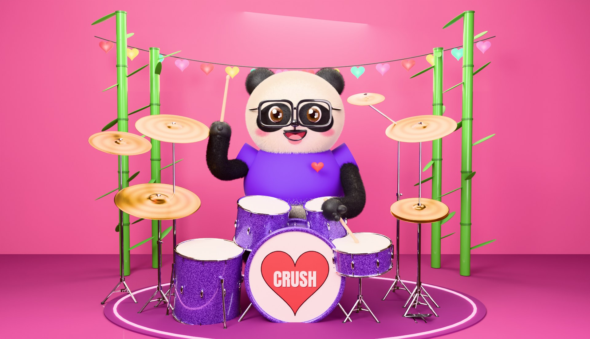

# The 3D panda

Everything on the Kit page (the room, every drum and cymbal, the panda's body, its 13 faces,
ears, sleeves, arms, paws and sticks) is modelled and rendered in Blender by `panda3d.py`, from
code: no hand-made assets. The plugin animates the rendered parts.



## Render

Needs Python 3.11+ with the `bpy` module (Blender as a Python module) and Pillow:

```
python -m venv blender_env && blender_env/bin/pip install bpy pillow
blender_env/bin/python panda3d.py preview out.png 1920 1104 96 happy   # the whole scene in one picture
blender_env/bin/python panda3d.py layers out/ 2 48                      # every part on its own layer
blender_env/bin/python panda3d.py layers out/ 2 48 head_wink,arm        # only some parts
cp out/*.png out/*.jpg out/manifest.json ../Resources/art/
```

`layers` renders each part alone on a transparent background (the room is still there for its
light, just not seen), trims it, saves it at 2x and 1x the 1280 x 736 stage, and writes
`manifest.json`: where each layer sat on the stage and where its anchors are (drum head
ellipses, the cymbal centres, the head centre and radius, shoulders, ear pivots, the two ends
of the arm and of the stick). A full run takes about an hour on 4 CPU cores.

## How the plugin uses them

`Source/gui/Skin.cpp` loads the layers and the manifest from the binary data;
`PandaStage::paintSkin` draws them. The camera in `panda3d.py` is matched to the stage, and the
kit's slots (`SLOTS`) are where the plugin puts each kind of drum, so a layer drawn where it
was rendered lines up with everything else. The stage then moves layers from there:

| Part | How it moves |
|---|---|
| Room | Drawn once as the background. |
| Drums, kick | One render per wrap (purple sparkle, brass, maple, chrome, walnut, black), scaled to the drum's size in inches, mirrored when it sits on the other side, the shell stretched for deeper or shallower drums. The head flashes and ripples on a hit. |
| Cymbals | One disc per kind, swinging on its stand (one stand per slot). Hi-hat: the top cymbal lifts with the pedal. |
| Body | Bounces on the kick and breathes. |
| Head | One render per face; tilts and nods to the beat and squashes on hits. The face follows the playing (smile, happy, open mouth, excited; laugh on a big crash, focused through tom fills, surprised by the first hit after a rest, a rock-out scowl on a solid china hit, a wink or tongue when idle, sad for a moment when you mark a hit bad, excited with both sticks up when the song stops) and blinks. |
| Ears | Wiggle about their roots. |
| Arms | Two copies of one furry tube with round ends (shoulder to elbow, elbow to paw), turned and stretched; the elbow bends out and down. The paw is turned with the stick so the thumb stays on top. Sleeves go over the tops of the arms and swing with them. |

## Faces

`neutral`, `happy`, `open_mouth`, `smile`, `focused`, `excited`, `wink`, `laugh`, `surprised`,
`tongue_out`, `angry`, `sad` (the reference sheet's twelve) and `blink`.

## Promo video

`promo.py` cuts the 46-second "Purafied – Panda Drums" promo:

```
PandaDrumsRender promo promo/                                  # the performance, from the plugin
python promo.py promo/ ../docs/panda3d.jpg Purafied-Panda-Drums-promo.mp4
```

The render tool plays a groove through D minor, C minor, E major, F# minor and A major (the kit
retunes to each and the floor tom sings a line in the key), tours the Lab, Mixer and Mapping
pages and ends on the panda's cheer. It writes the window's frames at 1.5x, the drums, and
`timeline.json` (when each key starts, what every drum is tuned to, where the kicks land).
`promo.py` adds the titles, captions and key cards, and a pad and bass that follow the same
keys and duck under the kick, so you hear the drums sit in each key. CI builds it with every
run (the Panda-Drums-preview artifact) and a release tag publishes it.
